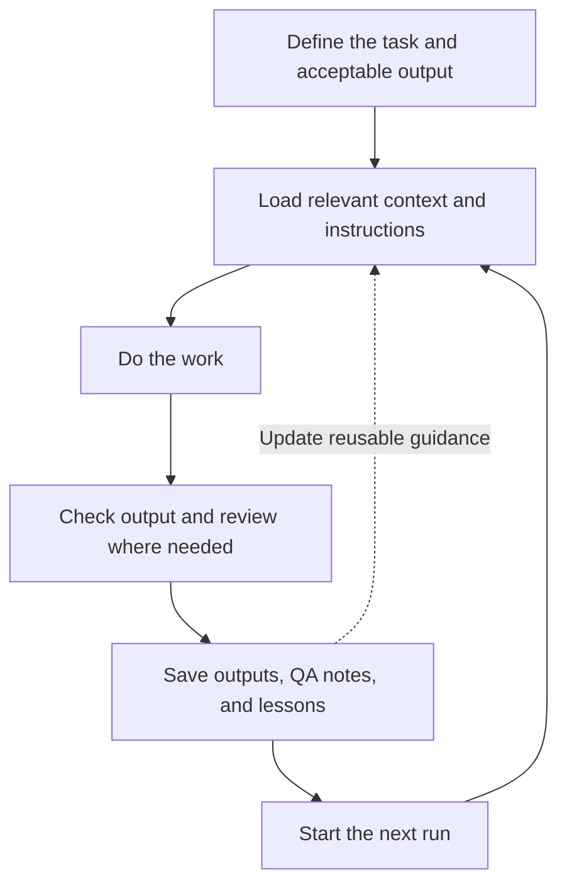

# Repository-driven AI workflows

*An exploration of repeatable GTM work.*

“Repository-driven AI workflows” is my descriptive label for keeping work materials together. A project folder holds context, reusable instructions, plans, scripts, inputs, outputs, QA records, logs, and lessons. The goal is repeatable, inspectable AI-assisted work without rebuilding context every conversation. This is not a standardized framework.

## Start simple

> Building a custom agent is often the wrong starting point. Before investing in orchestration, memory systems, and autonomous loops, see whether clear instructions, persistent files, scripts, and API access solve the problem. Build the simplest system that reliably gets the work done.

Unnecessary infrastructure consumes time and maintenance effort. An existing coding assistant may already supply file access, tools, scripts, and multi-step execution. Custom agents remain useful when requirements exceed those capabilities.

## How the workflow works

The value is the working process, not the folders themselves. Start with a task, define acceptable output and review points, preserve inputs, and record corrections. Scripts handle repeatable transformations; APIs supply current information or execute approved actions.



*An illustrative workflow: saved lessons improve the guidance available to the next run.*

Keep useful records alongside the work:

- **Plans:** Markdown files with goals, decisions, status, and next steps.
- **QA notes:** Checks, failures, and unresolved issues.
- **Run logs:** Dated inputs, commands, outputs, and fixes so future agents can resume work without repeating failed approaches.

Keep records current, distinguish planned from completed work, and store secrets in a `.env` file excluded from version control by `.gitignore`. Keep secrets out of logs.

### Turn repeatable work into skills

As a workflow becomes reliable, capture its instructions in a Markdown skill: when to use it, required inputs, steps, checks, and expected outputs. Keep the core instructions independent of any one tool so they can move between assistants. Scripts, integrations, and skill-loading formats may still need adapting.

## Run it repeatedly

### Schedule the work

If your assistant or agent harness supports scheduled tasks, a schedule can trigger the workflow using the instructions and context already stored in the repository. Each run can save dated outputs, QA findings, and logs for review. Define what runs automatically, what requires approval, and how failures or incomplete work should be surfaced. Use scheduling already available in the tool before building a custom scheduler.

### Work toward a defined outcome

Where an assistant or agent harness supports persistent goals, I could pair the repository's context and procedures with an objective that carries across turns. For example, Codex documents a `/goal` command for continuing toward a defined outcome with completion checks and constraints. [OpenAI's Goals guide](https://developers.openai.com/cookbook/examples/codex/using_goals_in_codex). Claude Code also offers [`/goal`](https://code.claude.com/docs/en/goal).

A schedule determines when work starts; a goal defines what the run should accomplish. Set limits on time, cost, and tool use, plus conditions for stopping or asking for input.

### Potential application: a sales signal brief

One workflow I want to test is a weekly sales signal brief: **“Which existing customers have a relevant reason to hear from us this week?”** Start with a small account list and two signal types. Research sources, assess relevance against customer context, and prepare a brief with links, dates, suggested actions, and uncertainty for human review.

Keep account context, qualification rules, outputs, and feedback in the repository. Define completion as a checked brief ready for review, including when no useful signals are found. Use salesperson feedback to improve the process and eventually capture it as a reusable skill. This is a proposed workflow, not a validated implementation.

## References and possibilities

These references inform my thinking; my own implementations and evidence are still developing. They do not establish that agents are unnecessary or that repository-based work always performs better.

### Related approaches

Jake Van Clief and David McDermott’s **Interpretable Context Methodology (ICM)** provides a closely related architectural reference: staged folders, explicit inputs and outputs, selective context loading, and separate reusable guidance and working artifacts. It still uses agents while reducing custom orchestration. Their paper reports preliminary practitioner experience, not controlled evidence of superior performance. [ICM paper](https://arxiv.org/html/2603.16021v2), [implementation repository](https://github.com/RinDig/Interpretable-Context-Methodology).

Vercel’s **Eve** extends a directory-based approach into deployed agents: Markdown instructions and skills sit alongside TypeScript tools, with a framework providing durable execution and integrations. I see this as a possible next step when requirements justify infrastructure beyond an existing assistant. [Vercel Eve](https://vercel.com/eve).

These external GTM examples are other teams’ work, not my implementations.

### Ad production at Anthropic

Producing fresh ads involved repeated copy creation, character checks, and movement between tools. Anthropic describes a Claude Code workflow that combines campaign performance data, existing copy, and keywords with reusable brand, product, and advertising instructions. A marketer refines and reviews the copy before export to a Google Ads upload-ready CSV. A related Figma plugin takes headline variations and a selected creative frame to generate creative permutations. [Anthropic’s marketing workflow](https://claude.com/resources/articles/how-anthropic-uses-claude-marketing).

### A literal folder-based workspace

Databar’s implementation guide addresses scattered GTM context with a proposed workspace containing ideal customer profile (ICP), positioning, voice, account notes, procedures, campaign materials, and CSV inputs and outputs. Reusable instructions and live data access support tasks such as account briefs and pipeline reviews, with results kept alongside campaign work. It is a setup guide, not evidence of a named company’s production results, and it also includes optional subagents and memory tooling. [Databar’s workspace guide](https://databar.ai/blog/article/claude-code-as-your-gtm-second-brain).

### Potential application: client service delivery

I see this approach fitting AI-native service businesses that deliver repeatable work for clients. Shared procedures and QA standards can guide delivery, while each client’s workspace holds their context, plans, inputs, deliverables, approvals, and lessons. The opportunity is a repeatable process with client-specific judgment and a clear record of the work. This is an application I’m exploring, not a validated business model.

## Try it yourself

This prompt is a practical adaptation inspired by Jake Van Clief and David McDermott’s [ICM](https://github.com/RinDig/Interpretable-Context-Methodology), not an official template. It is meant to get you started; adapt the instructions and structure to your workflow as needed. Use the copy button on the code block in GitHub, then paste it into your coding assistant.

```text
Help me set up a folder-based AI workspace inspired by Jake Van Clief and David McDermott’s Interpretable Context Methodology (ICM):
https://github.com/RinDig/Interpretable-Context-Methodology

First, ask me what workflow I want to repeat, what inputs I have, what deliverable I need, and where human review matters. Ask only what you need to propose a useful first version.

Then:
1. Propose the simplest folder structure that fits the workflow. Explain each folder’s purpose.
2. Separate reusable guidance, such as brand voice and quality standards, from inputs and outputs specific to each run.
3. Break the workflow into numbered stages where useful. Give each stage Markdown instructions defining its inputs, process, outputs, and review checkpoint.
4. Create a short root instruction file that maps the workspace and tells the assistant which files to read for each task. Avoid loading everything at once.
5. Include places for Markdown plans, QA findings, and dated run logs so future sessions can understand decisions, completed work, failures, and next steps.
6. Use scripts for mechanical steps when useful. Identify required API access without inventing integrations or storing credentials.
7. Walk through one example run and check that each stage produces what the next stage needs.

Keep the structure small. Do not create empty folders, unnecessary agents, or orchestration infrastructure. Mark missing information clearly and distinguish planned work from completed work.

Create the workspace locally after we agree on the structure. Do not send messages, publish outputs, modify external systems, commit, or push without my approval.

Treat this as a practical adaptation inspired by ICM, not an official implementation or a guarantee of better results.
```
