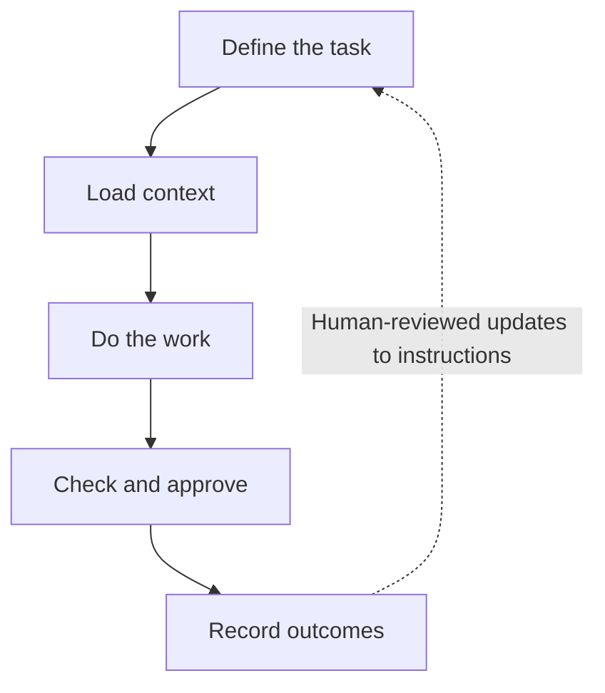

# Repository-driven AI workflows

*An exploration of repeatable GTM work.*

I’m exploring how to use a repository to keep AI-assisted work easy to repeat, review, and improve without rebuilding context every conversation. The folder holds the instructions, source material, tools, and records needed to continue the work. “Repository-driven AI workflows” is my label for this approach.

## Start simple

I would start with clear instructions, persistent files, scripts, and API access in an existing coding assistant. Custom agents and orchestration become worthwhile when the work needs capabilities that setup cannot provide.

## How the workflow works

Define acceptable output, check it before use, then track what happens afterward. Review the results before updating instructions, qualification rules, or skills. Scripts handle repeatable steps; APIs supply current information or carry out approved actions.



*Checking output and learning from outcomes are separate steps. Logs alone do not establish improvement. See Alex Lindahl’s [GTM learning loops](https://newsletter.gtmengineering.ai/p/future-of-gtm-self-learning-revenue).*

Keep useful records alongside the work:

- **Plans:** Goals, decisions, status, and next steps.
- **QA notes:** Checks, failures, and unresolved issues.
- **Run logs:** Dated inputs, actions, outputs, and fixes so future sessions can pick up the work.

Keep records current and distinguish planned from completed work. Keep secrets out of committed files and logs.

### Turn repeatable work into skills

Once a workflow is reliable, I would capture it as a Markdown skill: when to use it, required inputs, steps, checks, and outputs. Keeping the instructions independent of one tool makes them easier to reuse, though scripts, integrations, and skill formats may need adapting.

## Run it repeatedly

A schedule determines when work starts; a goal defines what the run should accomplish.

Where the assistant supports scheduling, I would use that before building a scheduler. Each run should report failures or unfinished work, with clear rules for what runs automatically and what needs approval.

For work that takes several rounds, a supported goal feature can keep the objective in view. Examples include Codex’s [`/goal`](https://developers.openai.com/cookbook/examples/codex/using_goals_in_codex) and Claude Code’s [`/goal`](https://code.claude.com/docs/en/goal). I would define completion checks, limits on time, cost, and tool use, and when to stop or ask for input.

### Potential application: a sales signal brief

One workflow I want to test is a weekly brief: **“Which existing customers have a relevant reason to hear from us this week?”** I would start with a small account list and two signal types, check whether each signal matters to the customer, and prepare a brief with sources, dates, suggested actions, and uncertainty for human review.

The repository would hold account context, qualification rules, outputs, and feedback. A checked brief completes the run, even when no useful signals are found. I would track which signals salespeople use and the resulting replies or meetings, then review the evidence before changing the rules.

## References and possibilities

These sources inform my thinking. The workflows above are proposals, and the external examples below are other teams’ work.

### Related approaches

Jake Van Clief and David McDermott’s **Interpretable Context Methodology (ICM)** separates reusable guidance from working files and loads context as needed. Its paper reports preliminary practitioner experience, not controlled evidence of better performance. [ICM paper](https://arxiv.org/html/2603.16021v2), [implementation repository](https://github.com/RinDig/Interpretable-Context-Methodology).

Vercel’s **Eve** combines Markdown instructions and skills with TypeScript tools, durable execution, and integrations. I see it as a possible next step when an existing assistant is no longer enough. [Vercel Eve](https://vercel.com/eve).

### GTM examples

**Anthropic’s ad workflow** combines campaign data and reusable brand instructions to draft copy that a marketer reviews before CSV export. It shows how existing tools can support a repeatable process with human review. [Anthropic’s marketing workflow](https://claude.com/resources/articles/how-anthropic-uses-claude-marketing).

**Databar’s workspace guide** brings positioning, customer context, procedures, and campaign files together for tasks such as account briefs and pipeline reviews. It is a setup guide rather than evidence of production results. [Databar’s workspace guide](https://databar.ai/blog/article/claude-code-as-your-gtm-second-brain).

I also see a potential use in client services: shared procedures and quality checks, with a separate workspace for each client’s context, deliverables, and approvals.

## Try it yourself

This setup prompt is inspired by Jake Van Clief and David McDermott’s [ICM](https://github.com/RinDig/Interpretable-Context-Methodology), not an official template. Copy it into your coding assistant and adapt it to your work.

<details>
<summary>Copy the setup prompt</summary>

```text
Help me set up a folder-based AI workspace inspired by Jake Van Clief and David McDermott’s Interpretable Context Methodology (ICM):
https://github.com/RinDig/Interpretable-Context-Methodology

First, ask me what workflow I want to repeat, what inputs I have, what deliverable I need, and where human review matters. Ask only what you need to propose a useful first version.

Then:
1. Propose the simplest folder structure that fits the workflow. Explain each folder’s purpose.
2. Separate reusable guidance, such as brand voice and quality standards, from inputs and outputs specific to each run.
3. Break the workflow into numbered stages where useful. Give each stage Markdown instructions defining its inputs, process, outputs, and review checkpoint.
4. Create a short root instruction file that maps the workspace and tells the assistant which files to read for each task. Avoid loading everything at once.
5. Include places for Markdown plans, QA findings, and dated run logs so future sessions can understand decisions, completed work, failures, and next steps.
6. Use scripts for mechanical steps when useful. Identify required API access without inventing integrations or storing credentials.
7. Walk through one example run and check that each stage produces what the next stage needs.

Keep the structure small. Do not create empty folders, unnecessary agents, or orchestration infrastructure. Mark missing information clearly and distinguish planned work from completed work.

Create the workspace locally after we agree on the structure. Do not send messages, publish outputs, modify external systems, commit, or push without my approval.
```

</details>
