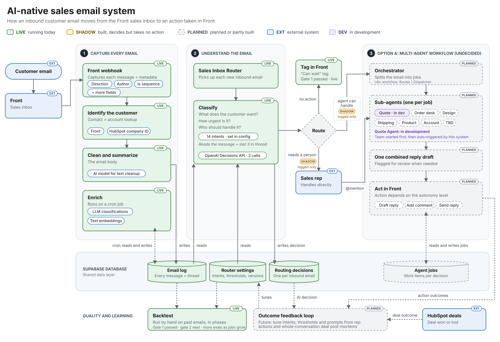

# AI-Native Sales Email System

I'm building a system around Sock Club’s sales inbox that extracts customer intent, identifies the jobs inside a conversation, and decides whether to hand each job to a teammate, a specialized agent, or a team of agents to deliver the work.

Sock Club is a high-volume, transactional business. At this stage of growth, I’m designing the system around the repeatable jobs that come through the sales inbox and the decisions that still need a person. A business with a different sales model would likely need to organize the work and draw those boundaries differently.

| Field | Value |
| --- | --- |
| Documentation status | Documentation draft |
| Project status | Active development. Email intake, enrichment, routing classification, and advisory “can wait” tagging are live with production traffic. Handoff recommendations are logged in shadow mode. The Quote Agent is in development. |
| Tools | Front, HubSpot, n8n, JavaScript, OpenRouter, Claude, OpenAI’s Decisions API, and Supabase |

## The problem

Sales and Sales Support teammates work from Front conversations, but the work inside a message often requires information or actions elsewhere. They need to understand the request, gather context, decide who should handle it, and follow through.

One email can contain several jobs. A customer asking for updated artwork and pricing has asked for two things, each with a different outcome and different ways it can go wrong.

*This direction also builds on findings from my [Sales Capacity Planner](../sales-capacity-planner/README.md): email jobs accounted for the largest share of estimated capacity demand. Offloading some of that work could free team capacity, improve the economics of serving accounts, and create more room for growth activity. These outcomes have not yet been measured.*

## My contribution

- **Personal responsibilities.** I’ve taken the project from the initial idea through architecture, technology selection, and implementation. I organized the system around jobs, built the shared context and routing pipeline, and used clustering to discover email intents.
- **AI assistance.** I used Claude to speed up implementation and review logged decisions for missing categories and mistakes in deciding which emails needed action.

## What I mean by AI-native

The litmus test is to remove the AI and see what changes. In an AI-assisted inbox, a person still interprets the request and drives the work. A summary or draft helps them do it faster. In an AI-native workflow, AI performs a core step. In this system’s design, recognizing and routing jobs are core steps that depend on AI.

AI-native describes how the workflow works. Earned autonomy determines which actions it can take on its own.

## How it works

### Capture and enrich emails

A Front webhook captures inbound and outbound messages. The n8n pipeline looks up the contact and account using Front and HubSpot, cleans and summarizes the message, then saves it with thread identifiers and message metadata in Supabase. A separate scheduled job generates embeddings and adds work classifications, including the task, category, work area, rationale, and classification version.

### Discover the 14 intents

I pulled roughly 6,000 inbound emails flagged as requiring action since the study began. I grouped their embeddings into clusters using a modified version of HDBSCAN, an unsupervised clustering algorithm. For each cluster, I took a handful of messages nearest its center (the centroid) and used an LLM to propose an intent label based on those examples.

That gave me a starting set of intents grounded in the work customers actually asked for, without having to guess at categories up front or label thousands of messages by hand. The patterns in those clusters also helped me decide what questions the router should ask and which items to define in the Decisions API. I’m still refining the categories. I built a playground to illustrate the method using examples that contain no proprietary data. [Email Vector Lab](https://email-vector-lab.jameson-on-the-rocks.chatgpt.site/)

### Classify inbound email

The Sales Inbox Router reads each new inbound message and up to three preceding messages in the thread. It makes two calls to [OpenAI’s Decisions API](https://developers.openai.com/api/docs/guides/decisions) to classify the request across 14 intents, assess urgency, and recommend who should handle it. Supabase holds the versioned intents and thresholds and records one decision per inbound email. Shadow runs log recommendations without acting in Front.

### Hand off and complete the work

Handoff and execution are the least developed stages. While the development team exposes the Portal+ MCP tools those workflows need, I can refine routing, prepare evaluations, and build specialized sub-agents.

The routing design has three paths for an inbound message. I’m still considering the architecture for the agent path:

- **Tag it** when the message needs no action.
- **Hand it to a sales rep** when a person should handle the request.
- **Send it for agent execution** to complete the jobs and prepare one reply draft, flagged for review when needed.

I’m considering two architectures for agent execution: an orchestrator coordinating specialized sub-agents, or a single agent loop that loads the instructions and tools it needs as the work progresses. [Anthropic’s findings](https://claude.com/resources/articles/building-agents-when-to-fold-subagents-into-your-main-agent-loop) suggest that keeping related work in one loop can reduce context loss and coordination overhead.

n8n’s current functionality limits how I could implement the single-loop approach for this use case, so it remains an option for later. My priority is stable execution, clear failure handling, and reliable outcomes. I haven’t yet evaluated which architecture best meets those needs.

The job’s autonomy tier determines what the system can do in Front, such as draft a reply, add an internal comment, or send an approved type of reply.

The [Quote Agent](../quote-agent/README.md) is in development as a rep-started workflow. Automatic handoff from the inbox router is planned.

## A routing decision from a historical replay

**The router saw a complaint and recommended no action.** A customer on a rush project replied to a quote to say the design tool kept changing their logo color, even after two attempts to fix it. They expected to approve the design in a few days and made no explicit request.

The v1.2 replay used the customer’s message and three earlier emails from the thread.

| Recorded decision | v1.2 replay |
| --- | --- |
| Needs-action score | Low |
| Problem score | 0.94 |
| Routing outcome | No action |

The rule checked the needs-action score first. That low score took precedence over the problem signal.

In the original conversation, the rep replied about 75 minutes later. They acknowledged the complaint, offered to submit the revisions, and asked which logo color to use. The retrospective replay only wrote to a test table.

I changed the rule so a problem score above 0.5 paired with a needs-action score below 0.3 sends the message to a person for review. Three later versions routed this same message to a person. Since the example informed the fix and other settings changed between replays, I still need to test whether the rule catches similar complaints in fresh mail.

I also set up a path to flag similar complaints for our product and development team. Once active, it will send them the feedback without requiring the rep to file a ticket.

## Jobs and earned autonomy

I'm building a job repository to track each job's trigger, desired outcome, measures, failure modes, frequency, impact, and priority. A separate autonomy matrix records its live tier, risk and reversibility, proposed next behavior, promotion evidence, and actions that must remain human.

| Tier | Who starts and completes the work |
| --- | --- |
| 0: Manual | A person initiates, prepares, and completes the job |
| 1: Human-triggered assistance | A person initiates; AI prepares; a person completes |
| 2: System-triggered assistance | The system initiates and prepares; a person completes |
| 3: Bounded autonomy | The system initiates and completes within defined policy |

Promotion is a decision about a specific job. Frequency alone does not justify more authority. Risk, recovery, output quality, and explicit human boundaries determine what can advance. Shadow testing lets me spot uncertain cases and review decisions against real work before granting the system more authority.

I plan to use OpenAI’s Decisions API to help choose how to handle a job based on the context of each request. The decision can adapt as the details change, while the job’s autonomy tier sets which actions are permitted and when a person needs to step in.

## Decisions and lessons

- **Architecture takes judgment.** The same lesson applies to software development and GTM engineering. It’s easier to get something working now, which makes it more valuable to know how to break the work into parts and choose the right tool for each one. That takes curiosity about what’s available and enough hands-on experience to know when a tool fits the job.
- **Expect to rebuild parts of the system.** There’s no fixed blueprint for this work. New tools become available, and building the workflow can reveal a simpler way to solve the same problem. I initially used a general-purpose LLM for routing and classification. Moving those decisions to OpenAI’s Decisions API with System 1 models made routing faster, cheaper to run, and much more predictable than my earlier setup. With more consistent outputs, I could remove some of the custom logic and simplify the pipeline.

- **Start evaluating early.** Evals are my least favorite part of building these systems, and they’re foundational to deciding what the system can do. Start with a review small enough to run, write down what it can tell you, and improve the method as you learn.

- **Organize project context like a repository.** I use a Claude Project as a working documentation repository, structured like the documentation I’d keep alongside a coding project on GitHub. Parent folders group the material, an overview folder contains a README, and numbered sections (01, 02, 03, and so on) organize topics such as routing configuration. Decision logs, evaluations, and implementation notes live in Markdown files. That gives Claude a history to reference and gives me documentation I can read, review, and update directly. Keeping that context organized has helped me navigate the system and revisit why earlier decisions were made.

## Progress and evidence

I’m refining the router’s decision logic in OpenAI’s Decisions API and building out the evaluation set.

| Evaluation | Result | What it supports |
| --- | --- | --- |
| Advisory “can wait” tagging | **Passed.** In a 300-email sample, 1 of the 121 emails marked no action needed action (0.8%, against a 2% bar). | Advisory tagging only. The 95% interval reaches about 4.5%, so I plan to recheck the miss rate on live traffic. |
| Intent and routing review | **No formal gate decision.** Of 50 decisions, 39 were right, 5 wrong, and 6 uncertain. The error rate among definite judgments was 11.4% (5 of 44). | The review exposed errors across intents. The working bar of about 5% applies per job, and this sample is too small to establish per-job readiness. |

The router is processing production emails, and advisory “can wait” tagging is live. Handoff recommendations are logged without automatically assigning or executing the work.

The intent review exposed confusion among date, shipping, status, and sample requests. The complaint above was marked uncertain and excluded from the error rate. Later versions were tuned on these cases, so the next step is a fresh labeled intent review. End-to-end job completion and time savings remain undocumented. [Evaluation methods and limitations](evaluations/source-notes.md)

I can use the stored email and decision records to build conversation traces tailored to this workflow without buying a separate tracing tool. A trace could show the messages the router considered, the intent it identified, and who it recommended should handle the work. As dispatch and execution come online, the trace could include job handoffs and outcomes.

## Supporting materials

- [Diagrams](diagrams/README.md)
- [Evaluations and evidence register](evaluations/README.md)
- [Earlier build journal (historical background)](https://jamesoncodes.github.io/articles/ai-native-email-system.html)
