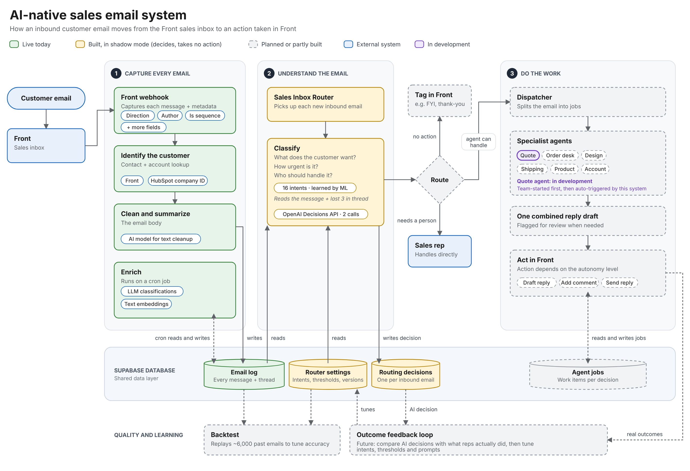

# AI Native Email System

I'm building a system around Sock Club’s sales inbox that extracts customer intent, identifies the jobs inside a conversation, and decides whether to hand each job to a teammate, a specialized agent, or a team of agents to deliver the work. Agents operate within the authority earned for that job: preparing work for human review or completing it within defined limits when evidence supports bounded autonomy.

## Metadata

| Field | Value |
| --- | --- |
| Documentation status | Documentation draft |
| Project status | In progress; shared context and category routing operating in shadow mode in the August 27, 2026 build journal. Downstream job identification and execution remain planned in that snapshot. |
| My role | Building the context and routing pipeline, defining jobs and autonomy boundaries, and developing evaluations |
| Timeline | Build journal published August 27, 2026; project start date not documented here |
| Tools | Front, n8n, JavaScript, OpenRouter, Claude, and Supabase |

This draft follows the [published build journal](https://jamesoncodes.github.io/articles/ai-native-email-system.html). Later implementation progress has not been verified against application source or production records. See [source notes](evaluations/source-notes.md).

## At a glance

- **Problem:** Teammates repeatedly reconstruct context and decide how to advance work spread across inbox conversations and internal systems.
- **Approach:** Extract shared context and intent, identify one or more jobs, then route each job to a human or specialized agents according to policy, confidence, and the authority earned by that job.
- **Implemented scope:** A shadow pipeline builds context, gates action versus no action, classifies categories, and logs decisions for analysis. It does not yet identify or execute individual jobs in the documented snapshot.

## The problem

Sales and Sales Support teammates work from Front conversations, but the work inside a message often depends on information elsewhere. They need to understand the request, gather context, decide who should handle it, and follow through.

An email is only the container. A customer asking for updated artwork and pricing has raised two jobs with different outcomes and failure modes. Treating the message as one task hides those distinctions and makes it harder to measure whether the work was completed well.

## My contribution

- **Personal responsibilities:** Defined jobs as the unit of work; built and refined the shared context and category-routing pipeline; created a batch analysis loop; defined the job repository and per-job autonomy framework.
- **Collaborators:** Senior teammates are intended to label evaluation examples. Completed labeling work and implementation responsibilities beyond my own are not documented here.
- **AI assistance:** Claude supports batch analysis of logged decisions to find taxonomy gaps and gate errors. Development assistance and model/provider assignments by component are not documented here.
- **Validation:** Logged conversations support iterative review. Formal, team-reviewed evaluation datasets for the gate and classifiers are described as in progress, not complete.

## How it works

*Conceptual architecture illustration. The documented implementation stops at context, gating, category classification, and logging; job identification, handoff to humans or specialized agents, execution, and outcome evaluation are intended downstream stages.*

The intended path is conversation → shared context → job identification → routing and policy decision → human or specialized agents → completion within the job’s authority → outcome evaluation.

The router determines what work is needed and whether to hand it to a teammate or specialized agents, passing along the shared context. A human handoff can be the intended path for the job. When agents handle the work, they stay within its permitted scope. Depending on the job’s autonomy tier, they prepare an output for a person to complete or deliver the work themselves within defined policy. Routing a job does not by itself grant permission to execute it.

The implemented shadow pipeline:

1. Reads real Front conversations through n8n and builds a shared context snapshot: intent, desired outcome, urgency, state, quantities, dates, and linked system identifiers.
2. Decides whether the latest message calls for action.
3. Routes it into one of five action categories or five no-action categories, recording a secondary category when needed.
4. Logs decisions, extracted details, confidence scores, and unknowns in Supabase. It sends no customer messages and makes no workflow changes.
5. Accumulates batches of 100–200 conversations for analysis with Claude. I inspect overlapping categories, gate errors, missed secondary categories, and context extracted from the wrong part of a thread, then refine the pipeline.

A category identifies the area of work. The next layer must distinguish the specific jobs within it before handing each one to the appropriate teammate or specialized agents. Unknown preserves uncertain cases for review and further discovery.

See [diagram notes](diagrams/README.md) for the distinction between intended architecture and implemented scope.

## Jobs and earned autonomy

I'm building a job repository to track each job's trigger, desired outcome, measures, failure modes, frequency, impact, and priority. A separate autonomy matrix records its live tier, risk and reversibility, proposed next behavior, promotion evidence, and actions that must remain human.

| Tier | Who starts and completes the work |
| --- | --- |
| 0: Manual | A person initiates, prepares, and completes the job |
| 1: Human-triggered assistance | A person initiates; AI prepares; a person completes |
| 2: System-triggered assistance | The system initiates and prepares; a person completes |
| 3: Bounded autonomy | The system initiates and completes within defined policy |

The job’s tier governs the authority of the agents handling it, including when human completion is required. Promotion is a decision about a specific job. Frequency alone does not justify more authority. Risk, recovery, output quality, and explicit human boundaries determine what can advance. Shadow testing lets me inspect proposed behavior against real work before granting it more initiative or execution authority.

## Results and evidence

The documented result is a working discovery loop: real conversations produce routing logs, batch analysis informs changes, and those changes feed the next run. This is a source-reported process observation, not a measured accuracy or business-outcome result.

No router accuracy score, end-to-end job-completion rate, or system-wide time savings are available here. The journal's informal assessment of taxonomy coverage is not an evaluation score. See the [evidence register](evaluations/source-notes.md) for scope and gaps.

## Decisions and lessons

- **Shared context first:** A common case file avoids rebuilding extraction logic for every downstream job and helps locate the source of errors.
- **Discover before executing:** Shadow routing reveals workload patterns and uncertain cases while preserving human control of live work.
- **Evaluate each stage:** Separate tests for the gate and classifiers make model and prompt changes easier to assess.
- **Measure the delivered outcome:** Completing a step quickly is insufficient if the next person receives incomplete work. Autonomy needs evidence about quality as well as speed.

## Current state and next steps

The verified documentation baseline remains the August 27 journal. The universal router is in shadow mode; downstream job identification and execution are not established by that source.

The next work described there is to build three evaluation datasets for the action gate, action categories, and no-action categories; obtain senior-teammate labels; compare models and prompts; and inspect remaining errors. Job definitions and promotion criteria need to be established before expanding execution authority.

The next documentation update needs dated implementation evidence, reviewed evaluation results, and examples of how a job is routed and completed within its permitted authority.

## Supporting materials

- [Diagrams](diagrams/README.md)
- [Evaluations and evidence register](evaluations/README.md)
- [Original build journal](https://jamesoncodes.github.io/articles/ai-native-email-system.html)
