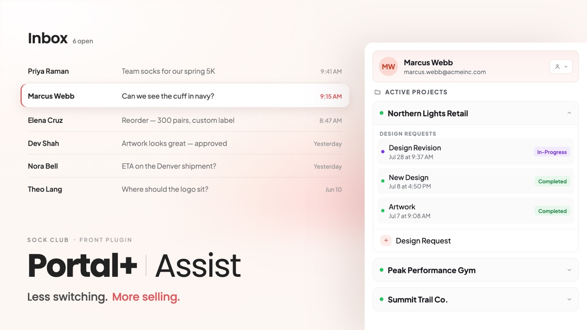
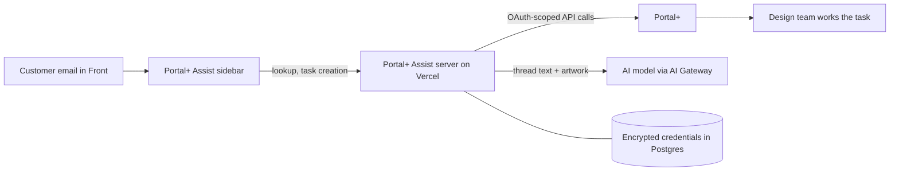

# Portal+ Assist

A Front sidebar that lets Sock Club’s sales team look up customer projects and create design tasks in Portal+ without leaving the email conversation, including an AI-drafted design brief.

## Metadata

| Field | Value |
| --- | --- |
| Documentation status | Documentation draft |
| Project status | In production for internal use |
| My role | Product planning, implementation, deployment, and maintenance; {{Confirm overall ownership and collaborators}} |
| Timeline | Development began June 2026; first production release July 30, 2026. {{Confirm development duration and whether part-time}} |
| Tools | Next.js, React, TypeScript, Tailwind, Supabase Postgres, Vercel, Front Plugin SDK, Vercel AI SDK, AI Gateway, PostHog |

## Problem and solution

- **Users and previous workflow:** Sock Club’s sales and sales support teammates work with customers in Front, a shared email inbox. Projects, designs, and tasks that hand work to Design live in Portal+, our internal order system. Creating a request meant leaving the conversation, finding the right customer and project, and transferring details from emails and attachments.
- **Friction:** Manual transcription and handoffs interrupted the sales workflow. Design tasks did not always make clear whether the client wanted an exact recreation, a specific concept, or open exploration.
- **What changed:** The sidebar identifies the customer, shows their projects and existing requests, and supports new design, revision, and production-files tasks inside Front. Classify can prepare a structured design brief for new requests.
- **Human judgment:** Sales reviews and edits the prepared work before clicking **Create task**. Portal+ remains available for full control and complex exceptions.

## My contribution

- **Planning:** Wrote the authentication strategy, analytics plan, Portal+ API reference, Classify design plan, and large-upload plan.
- **Implementation:** Built the plugin, server routes, Portal+ OAuth integration, database schema, and Classify pipeline.
- **Deployment and maintenance:** Set up CI and Vercel deployment and shipped iterative releases, including fixes driven by teammate reports.
- **Collaborators:** Sales support requested in-plugin client renaming, and a teammate’s failed upload led to clearer size limits. {{Confirm other testing and rollout contributors}}
- **AI-assisted development and validation:** Used Claude Code and AI code review, supported by reference documents for Portal+ API behavior and the design system. Verified features against a live Portal+ environment before merging.

## Demo

### New Design Request

https://github.com/user-attachments/assets/be65b427-5c96-40e9-89a3-b8873b3522af

### Design Revision Request

https://github.com/user-attachments/assets/85fd1569-0e7e-4d00-9fb3-3b543f4e9d0c

## How it works

- **Customer and project context:** The sidebar filters internal and CRM addresses when selecting the customer. Project cards show deal stage, assigned designer, and existing design requests.
- **Task creation:** Fields adapt to the task type. Revisions use a visual picker of existing designs and versions; priorities load per task type. Teammates can suppress Portal+’s task-completion notification to the client.
- **Integrations and access:** Server routes on Vercel call Portal+ through app-managed OAuth. Portal+ tokens stay encrypted in Postgres; the browser receives a revocable app session. Requests are checked against Front’s plugin secret and the app’s origin, and Portal+ error logs are redacted.
- **Quality checks:** As of October 15, 2026, 320 automated tests in 32 files passed locally across API routes, authentication, Portal+ integration, and Classify parsing and validation. CI runs tests, linting, type checks, a production build, and a fresh database migration on pull requests.

### Classify: preparing design direction

I met with the Director of Creative Operations to understand what she wanted in an ideal design brief. I codified those learnings into Classify’s structured output, making that guidance available to every teammate preparing a new design request.

For new design requests with uploaded artwork, Classify reads the latest part of the email thread and up to six files using a vision-capable model through AI Gateway. PDF, Illustrator, and EPS proofs are converted to images on the server first.

- **Draft:** A structured Design Direction block includes a request type (Recreate Template, Specific Ask, Inspired Direction, or Standard Deck), a short rationale, use case, and style and logo notes. Chassis type, packaging, and sales notes are forced blank for Sales to complete. Revisions do not support Classify.
- **Validation:** The prompt instructs the model to use explicit client information and return `n/a` when direction is ambiguous. The server checks allowed categories, features, and field limits, blanking invalid fields. These checks constrain structure; they do not establish factual accuracy.
- **Re-classification:** A new run replaces the previous generated block. Edits inside that block can be overwritten. Changed attachments do not automatically trigger a new run or warn that the draft may be stale.

## Results and evidence

The findings below come from the codebase review and development history supplied for this draft. Team feedback is qualitative; deployment and test counts describe delivery and validation, rather than business impact. Analytics were added after launch, so there is no instrumented pre-launch task-time baseline.

| Metric or observation | Before | After or current finding | Evidence type | Measurement period | Source |
| --- | --- | --- | --- | --- | --- |
| Where design tasks are created | In Portal+, outside the email conversation | In the Front sidebar alongside the conversation | Product capability | Since July 2026 | Application |
| Classify usefulness on a real thread | Not recorded | A sales teammate reported that Classify captured the right details from a multi-email thread | Qualitative feedback; single report | August 19, 2026 | Private Front conversation |
| Client name corrections | Leave the plugin to correct a client name | Rename in the sidebar, verified by reading Portal+ back | Shipped workflow improvement | August 3, 2026 | Source repository PR #11 |
| Large upload failures | Misleading authentication error | Size checked before upload with a clear message | Reported issue resolved | August 4, 2026 | Source repository PR #12 |
| Production deployments | Not applicable (not yet launched) | 13 production deployments | Deployment count | July 30–October 8, 2026 | Vercel deployment records on GitHub |

{{Add PostHog usage counts, task-creation timings, and Classify draft retention or editing rates with actual reporting periods. Do not present uncollected values as measured results.}}

## Decisions and lessons

- **Own OAuth where the host cannot:** Front’s OAuth relay was unavailable for private plugins. App-managed OAuth keeps tokens server-side but adds responsibility for refresh, rotation, revocation, and concurrent refresh handling. Temporary upstream outages do not automatically clear stored credentials.
- **Validate AI output in the application:** Model changes exposed inconsistent labels, malformed fields, and provider schema incompatibilities. Local parsing and validation reduce provider dependence, while editable drafts preserve review of valid but incorrect answers.
- **Keep business decisions human-owned:** Chassis type, packaging, and sales notes depend on decisions that may not exist in the conversation, so Classify leaves them blank.
- **Test native dependencies in production:** Duplicate image-library binaries caused Classify to fail in deployment despite working locally. Fixing dependency resolution and the production bundler reinforced the need to validate native dependencies in the hosting environment.
- **Make platform limits visible:** Vercel’s request-body limit is lower than Portal+’s upload limit. The plugin enforces a clear 4 MB limit; direct-to-storage uploads remain planned.
- **Instrument before launch:** Adding analytics after release limited before-and-after comparisons. Future workflows should establish measurement before rollout.

## Supporting materials

- [Videos and hosted demos](videos/README.md)
- **Source repository:** {{Link the existing source repository if shareable}}
- **Related case study:** [AI Native Email System](../ai-native-email-system/README.md)
