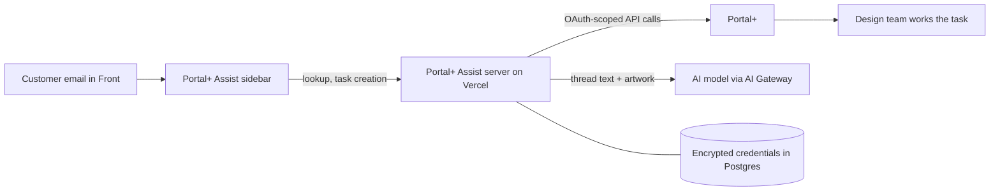

# Portal+ Assist

A Front sidebar that lets Sock Club’s sales team look up customer projects and create design tasks in Portal+ without leaving the email conversation, including an AI-drafted design brief.

## Metadata

| Field | Value |
| --- | --- |
| Documentation status | Documentation draft |
| Project status | In production for internal use |
| My role | Product planning, implementation, deployment, and maintenance; {{Confirm overall ownership and collaborators}} |
| Timeline | Development began June 2026; deployed to production August 1, 2026. {{Confirm development duration and whether part-time}} |
| Tools | Next.js, React, TypeScript, Tailwind, Supabase Postgres, Vercel, Front Plugin SDK, Vercel AI SDK, AI Gateway, PostHog |

## Problem and solution

- **Users and previous workflow:** Sock Club’s sales and sales support teammates work with customers in Front, a shared email inbox. Projects, designs, and tasks that hand work to Design live in Portal+, our internal order system. Creating a request meant leaving the conversation, finding the right customer and project, and transferring details from emails and attachments.
- **Friction:** Manual transcription and handoffs interrupted the sales workflow. Design tasks did not always make clear whether the client wanted an exact recreation, a specific concept, or open exploration.
- **What changed:** The sidebar identifies the customer, shows their projects and existing requests, and supports new design, revision, and production-files tasks inside Front. Classify can prepare a structured design brief for new requests.
- **Human judgment:** Sales reviews and edits the prepared work before clicking **Create task**. Portal+ remains available for full control and complex exceptions.

## My contribution

- **Planning:** Wrote the authentication strategy, analytics plan, Portal+ API reference, Classify design plan, and large-upload plan.
- **Implementation:** Built the plugin, server routes, Portal+ OAuth integration, database schema, and Classify pipeline.
- **Deployment and maintenance:** Set up CI and Vercel deployment and shipped iterative releases, including fixes driven by teammate reports.
- **Collaborators:** Sales support requested in-plugin client renaming, and a teammate’s failed upload led to clearer size limits. {{Confirm other testing and rollout contributors}}
- **AI-assisted development and validation:** Used Claude Code and AI code review, supported by reference documents for Portal+ API behavior and the design system. Verified features against a live Portal+ environment before merging.

## Demo

### New Design Request

https://github.com/user-attachments/assets/be65b427-5c96-40e9-89a3-b8873b3522af

### Design Revision Request

https://github.com/user-attachments/assets/85fd1569-0e7e-4d00-9fb3-3b543f4e9d0c

## How it works

- **Customer and project context:** The sidebar filters internal and CRM addresses when selecting the customer. Project cards show deal stage, assigned designer, and existing design requests.
- **Task creation:** Fields adapt to the task type. Revisions use a visual picker of existing designs and versions; priorities load per task type. Teammates can suppress Portal+’s task-completion notification to the client.
- **Integrations and access:** Server routes on Vercel call Portal+ through app-managed OAuth. Portal+ tokens stay encrypted in Postgres; the browser receives a revocable app session. Requests are checked against Front’s plugin secret and the app’s origin, and Portal+ error logs are redacted.
- **Quality checks:** As of October 15, 2026, 320 automated tests in 32 files passed locally across API routes, authentication, Portal+ integration, and Classify parsing and validation. CI runs tests, linting, type checks, a production build, and a fresh database migration on pull requests.

### Classify: preparing design direction

I met with the Director of Creative Operations to understand what she wanted in an ideal design brief. I codified those learnings into Classify’s structured output, making that guidance available to every teammate preparing a new design request. The goal is to give Design clearer direction upfront and reduce requests that need a second full design cycle before the customer sees something usable.

For new design requests with uploaded artwork, Classify reads the latest part of the email thread and up to six files using a vision-capable model through AI Gateway. PDF, Illustrator, and EPS proofs are converted to images on the server first.

- **Draft:** A structured Design Direction block includes a request type (Recreate Template, Specific Ask, Inspired Direction, or Standard Deck), a short rationale, use case, and style and logo notes. Chassis type, packaging, and sales notes are forced blank for Sales to complete. Revisions do not support Classify.
- **Validation:** The prompt instructs the model to use explicit client information and return `n/a` when direction is ambiguous. The server checks allowed categories, features, and field limits, blanking invalid fields. These checks constrain structure; they do not establish factual accuracy.
- **Re-classification:** A new run replaces the previous generated block. Edits inside that block can be overwritten. Changed attachments do not automatically trigger a new run or warn that the draft may be stale.

## Results and evidence

| Metric or observation | Before | After or current finding | Evidence type | Measurement period | Source |
| --- | --- | --- | --- | --- | --- |
| Design tasks submitted through Portal+ Assist | Not applicable (not yet launched) | Over 1,500 | Reported usage count | August 1–October 16, 2026 | Internal reporting, supplied by author |
| Time to complete a design-request submission | Approximately 4 minutes through Portal+, based on manual team time logging | Approximately 50 seconds median through Portal+ Assist | Manually timed baseline; measured current median | Baseline: before launch, dates not recorded; current analytics window not specified | Team time logging; PostHog analytics |
| Request-submission capacity | Manual submission workflow | Approximately 0.03–0.06 FTE equivalent capacity returned from design requests alone | Annualized projection | Annualized; as of October 16, 2026 | Author’s capacity projection |
| Design rework | Approximately 1 in 5 requests requires a second full design cycle before the customer sees something usable | Reduction through clearer Classify briefs is intended; not yet measured | Team-reported baseline; outcome pending | Baseline period not specified | Author’s account |
| Potential Design capacity | Rework consumes design time | Projected 168 hours/year, approximately 1% of capacity across roughly eight designers | Annualized projection; not measured savings | Annualized; as of October 16, 2026 | Author’s capacity projection |

The timing comparison uses different collection methods; a matched study and sample sizes are not documented here. Submission capacity and potential Design capacity are separate projections and should not be added together as demonstrated savings. The Design projection describes potential room for work the team cannot take on today; a reduction in second-cycle work has not yet been established.

{{Add annual request volume, working-hours assumptions, and the calculation behind the 0.03–0.06 FTE projection. For the Design projection, add assumed cycle duration and reduction in second-cycle requests, plus the annual team-capacity denominator.}}

## Decisions and lessons

- **Own OAuth where the host cannot:** Front’s OAuth relay was unavailable for private plugins. App-managed OAuth keeps tokens server-side but adds responsibility for refresh, rotation, revocation, and concurrent refresh handling. Temporary upstream outages do not automatically clear stored credentials.
- **Validate AI output in the application:** Model changes exposed inconsistent labels, malformed fields, and provider schema incompatibilities. Local parsing and validation reduce provider dependence, while editable drafts preserve review of valid but incorrect answers.
- **Keep business decisions human-owned:** Chassis type, packaging, and sales notes depend on decisions that may not exist in the conversation, so Classify leaves them blank.
- **Test native dependencies in production:** Duplicate image-library binaries caused Classify to fail in deployment despite working locally. Fixing dependency resolution and the production bundler reinforced the need to validate native dependencies in the hosting environment.
- **Make platform limits visible:** Vercel’s request-body limit is lower than Portal+’s upload limit. The plugin enforces a clear 4 MB limit; direct-to-storage uploads remain planned.
- **Use consistent timing methods:** The manual pre-launch time logs provide a starting point, while PostHog captures the current workflow. Instrumenting before rollout would make future comparisons more consistent.

## Supporting materials

- [Videos and hosted demos](videos/README.md)
- **Source repository:** {{Link the existing source repository if shareable}}
- **Related case study:** [AI Native Email System](../ai-native-email-system/README.md)
