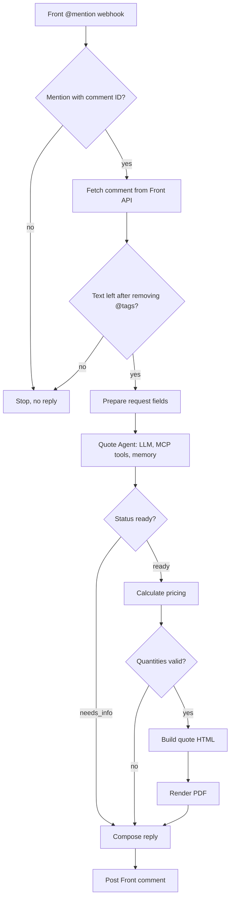

# Quote Agent

An n8n workflow that turns a sales rep's @mention in a Front conversation into a priced, formatted PDF quote for custom socks and packaging, using Sock Club's MCP server tools to retrieve live product and customer data.

## Metadata

| Field | Value |
| --- | --- |
| Documentation status | Documentation draft |
| Project status | Testing phase |
| Production use | Not yet in production |
| My role | {{Describe my ownership and responsibilities}} |
| Timeline | {{Provide development dates or duration}} |
| Development mode | Part-time |
| Tools | n8n Cloud; Front webhook, REST API, and MCP server; Sock Club MCP server tools; OpenRouter (Claude Sonnet 5.5 for the agent, DeepSeek for output-parser repair); Postgres chat memory; PDF.co HTML-to-PDF rendering |

## Problem and solution

Sock Club sales reps read incoming emails in Front, interpret the customer's intent, and determine when a quote is needed. In the current workflow, the account manager hands the task to a sales support rep, who navigates Portal+ to generate the quote, posts a comment in the Front conversation explaining what was created, attaches the PDF, and reassigns the conversation to the account manager.

The main bottleneck is the time the quote request spends waiting in the sales support queue. Sales support reps handle many competing tasks, so a quote can sit before anyone starts preparing it. That wait can delay delivery to the customer or prospect beyond the time needed to create and review the quote.

I wanted to reduce that queue time by preserving the handoff structure while giving an agent the job of preparing the quote and returning it to the conversation for the account manager to review.

A rep @mentions the agent in a Front comment, providing context about the request and instructions for the quote they want prepared. The agent gathers customer and product facts through Sock Club's MCP server tools, asks follow-up questions when essentials are missing, and returns a structured quote configuration. Code calculates prices and builds the layout, PDF.co renders the PDF, and the workflow posts a link in the same Front conversation.

The planned next step is to create a draft email reply with the quote attached, so the sales rep can review, edit, and approve it before sending. Draft email creation and quote attachment are not yet implemented.

Quotes must use the pricing rules that apply to the customer's account. The agent must confirm the customer, products, quantities, account classification, and account manager rather than guess, and retrieve prices through Sock Club's MCP server tools.

The rep supplies or confirms those essentials by @mentioning the agent again. Notes identify sources and assumptions for review, such as an assumed header card variant or a customer not found in the customer records. The PDF reminds the rep to confirm sock size because prices are per size. The workflow does not send the quote to the customer; the rep reviews it first.

## My contribution

- **Personal responsibilities:** {{Describe which parts I designed, built, and tested}}.
- **Collaborators:** {{Identify collaborators and their contributions}}.
- **AI assistance during development:** {{Describe whether and how AI assisted the original build}}. I also had Claude review the workflow for technical issues; those findings are listed under Limitations.
- **Runtime AI:** Claude runs the quote agent, and DeepSeek repairs malformed structured output.
- **Validation:** {{Provide testing and validation work beyond the reported Claude review}}.

## Demo

No screenshots, recordings, or hosted demo are available yet. {{Provide a shareable demo when available}}.

**Synthetic example:** This illustrates the designed behavior. It is not a recorded run.

1. **Input:** A rep posts: “@QuoteAgent 250 and 500 pairs of a crew sock with header cards for this customer, with the upsell.”
2. **Lookup:** The agent looks up the contact and calls `get_user` for customer type and account manager. It finds the sock and header card products and loads their price breaks.
3. **Clarification:** If account classification is absent from both the request and customer records, it returns `needs_info` with a question such as “Which pricing rules apply to this account?” The workflow posts the question in Front. The customer reference must also be resolved before proceeding.
4. **Quote:** Once essentials are available, the agent returns two quote configurations, one per quantity. Code prices both quotes and builds the next-break comparison, then the PDF is rendered.
5. **Outcome:** A comment in the same conversation reads “Quote ready: View quote PDF,” linking to the PDF.

## How it works

The Front @mention webhook carries event, conversation, and comment IDs. The workflow fetches the comment text from the Front API, keeps only mention events with a comment ID, and stops if no text remains after removing @tags. It prepares the request text, requester name, email and ID, conversation ID, and posted time in Central time.

The agent combines the request with earlier turns from the same Front conversation and looks up customer, account manager, product, and price-break data. Its structured output is either `needs_info` with short questions or `ready` with a quote configuration. The request-preparation conflict described under Limitations affects customer selection during testing.

*Workflow from Front intake to the reply in the original conversation.*

### Components

| Component | What it does |
| --- | --- |
| Quote Agent | n8n AI agent using Claude Sonnet 5.5 at temperature 0.1, with up to 20 iterations and a structured output parser |
| Sock Club MCP client | Nine read-only tools: list and get contacts, get user, get and list companies, list internal users, list product types, and get and list price sets |
| Postgres chat memory | Uses the Front conversation ID as its key and retains the last 10 turns for follow-ups |
| Output parser | Enforces the JSON schema and uses a second, cheaper model for an auto-fix pass |
| Calculate Pricing Code node | Selects price breaks, rounds to cents, validates minimums, builds the upsell, and collects errors and warnings |
| Build Quote HTML Code node | Builds the layout, using a text wordmark when no logo URL is set |
| PDF.co | Renders a letter-size portrait PDF with a page-number footer |
| Front MCP server | Posts the reply as a comment in the original conversation |

Each ready PDF has one section per quote, showing product lines, quantities, unit prices, line totals, tax, shipping, and a total. Net-priced quotes are marked **NET**. When requested, a green upsell box shows the next price break and added cost.

### Decision logic

- **Pricing rules:** Use the request first, then the account classification on the user record returned by `get_user`, then the company record. Ask if the applicable pricing rules remain unclear.
- **Account manager:** Use the request, otherwise the user record returned by `get_user`, with a name lookup to confirm. Ask if neither provides one.
- **Customer:** Must come from the request text, never the requester's own name or email. A conflicting test override is described below.
- **Products:** Select the named variant. A plain “header card” defaults to Domestic, with the assumption noted. Ask if ambiguity remains.
- **Price math:** The agent selects price breaks; code applies the highest break at or below each line's quantity.
- **Upsell:** Off unless requested. When enabled, use the next break of the sock line and reprice every line at that quantity. When off, notes tell the rep the quote was built without it.
- **Questions:** Ask all open questions together, each under 12 words. Do not ask about upsell or shipping.

### Error handling and review

Missing essentials return `needs_info`; the workflow posts the questions to Front. Quantities below a product's minimum stop PDF generation and produce a “Below minimum” message requesting a new quantity.

The pricing step attaches warnings for totals over $4,000, where a 3.5% card fee applies, missing shipping, and sock size to confirm. The card-fee warning has a delivery gap described below. Sock Club MCP tool calls have a 60-second timeout, the agent loop is capped at 20 iterations, and the output parser retries malformed output through its auto-fix model.

Human review happens through follow-up comments and notes for the rep. Monitoring and alerting are not implemented.

## Results and evidence

The workflow is in testing and is not yet in production. Measured outcomes and an evaluation set have not been recorded.

- **Baseline:** {{Provide baseline measurements for the sales support quoting workflow}}.
- **Measured results:** {{Provide observed outcomes, methodology, sample size, measurement period, and evidence source}}.
- **Source material:** {{Provide a shareable source repository and review notes}}.

The synthetic demo above is an illustration of intended behavior, not evidence of successful execution.

## Decisions and lessons

The workflow uses the following design choices. Alternatives considered and most reasons are {{to be provided}}.

- **LLM gathers data; code calculates and renders:** The prompt limits the agent to gathering facts and selecting price breaks. Downstream code handles totals and layout.
- **Memory per Front conversation:** Follow-up @mentions can combine with earlier answers in the same thread.
- **Ask instead of guessing essentials:** The prompt requires clarification for the five essential fields and prohibits prices from memory.
- **Optional upsell:** The comparison is included only when requested.
- **Two models:** A stronger model runs the agent and a cheaper model repairs malformed output. The reason for this split is {{to be provided}}.
- **Lessons learned:** {{Describe lessons from building, testing, or operating the workflow}}.

## Limitations

Claude identified the following potential issues during a workflow review. Verification and remediation are still to be documented.

- **Hardcoded customer email:** Request preparation sets `customer_email` to a fixed test address, and the prompt tells the agent to use it as the customer. This conflicts with the rule that the customer must come from the request text.
- **PDF link lifetime:** The PDF step sets an expiration value of `1440`, apparently in minutes. Links would then expire after 24 hours, while quotes are valid for seven days by default.
- **No webhook verification:** Front sends a signature header, but the workflow does not validate it.
- **No duplicate-event protection:** A retried event could run the agent twice, post duplicate comments, and add duplicate memory turns.
- **Silent drops:** Mentions that fail the filters receive no reply. Comment fetching has no retry or error handling.
- **Transcribed price breaks:** The agent copies price breaks from Sock Club's MCP tools into the configuration and the code trusts them. A transcription error could reach the PDF.
- **Price lookup edge case:** If a quantity passes the minimum check but falls below the lowest price break, lookup returns `null` and the line would price at zero.
- **Tax and fee gaps:** Tax is fixed at zero. The card fee over $4,000 appears only as a warning that is not posted to Front.

{{Record verification and remediation status as these findings are reviewed}}.
