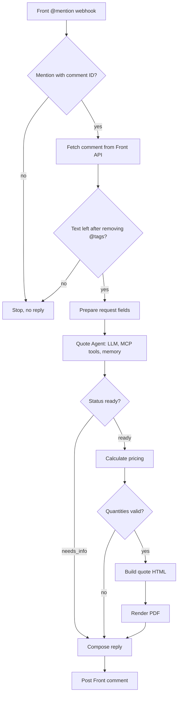

# Quote Agent

An n8n workflow that turns a sales rep's @mention in a Front conversation into a priced, formatted PDF quote for custom socks and packaging, using Sock Club's MCP server tools to retrieve live product and customer data.

## Metadata

| Field | Value |
| --- | --- |
| Documentation status | Documentation draft |
| Project status | Testing phase |
| Production use | Not yet in production |
| My role | Built the agent in n8n, from concept to working implementation |
| Timeline | {{Provide development dates or duration}} |
| Development mode | Part-time |
| Tools | n8n Cloud; Front webhook, REST API, and MCP server; Sock Club MCP server tools; OpenRouter (Claude Sonnet 5.5 for the agent, DeepSeek for output-parser repair); Postgres chat memory; PDF.co HTML-to-PDF rendering |

## Problem and solution

Sock Club sales reps read incoming emails in Front, interpret the customer's intent, and determine when a quote is needed. In the current workflow, the account manager hands the task to a sales support rep, who navigates Portal+ to generate the quote, posts a comment in the Front conversation explaining what was created, attaches the PDF, and reassigns the conversation to the account manager.

The bottleneck is queue time. Sales support reps handle competing tasks, so a quote request can wait before preparation begins, delaying delivery to the customer or prospect.

I wanted to reduce that queue time by preserving the handoff structure while giving an agent the job of preparing the quote and returning it to the conversation for the account manager to review.

A rep @mentions the agent in a Front comment with context and instructions for the quote. The agent retrieves customer and product data through Sock Club's MCP tools, asks for missing essentials, and prepares the quote. The workflow calculates prices, generates a PDF, and posts a link in the same conversation.

The planned next step, not yet implemented, is a draft email reply with the quote attached for the sales rep to review, edit, and approve before sending.

Quotes must follow the pricing rules that apply to the customer's account. The rep answers follow-up questions by @mentioning the agent again and reviews the quote, sources, and assumptions before sending it to the customer. The workflow does not send customer emails.

## My contribution

- **Personal responsibilities:** I took the agent from concept to a working implementation, choosing n8n as the runtime and building the workflow, integrations, and decision logic.
- **Collaborators:** Ryu Watanabe developed the MCP server tools. Joshua Varghese developed the initial skills that informed the agent's system prompt.
- **AI assistance during development:** I used AI to help brainstorm the initial architecture.
- **Validation:** Evaluations must be created and run before production; this work is planned.

## Demo

No screenshots, recordings, or hosted demo are available yet. {{Provide a shareable demo when available}}.

**Synthetic example:** This illustrates the designed behavior. It is not a recorded run.

1. **Input:** A rep posts: “@QuoteAgent 250 and 500 pairs of a crew sock with header cards for this customer, with the upsell.”
2. **Lookup:** The agent looks up the contact and calls `get_user` to identify the pricing rules that apply to the customer's account and the account manager. It finds the sock and header card products and loads their price breaks.
3. **Clarification:** If the applicable pricing rules cannot be determined from the request or customer records, it returns `needs_info` with a question such as “Which pricing rules apply to this account?” The workflow posts the question in Front. The customer reference must also be resolved before proceeding.
4. **Quote:** Once essentials are available, the agent returns two quote configurations, one per quantity. Code prices both quotes and builds the next-break comparison, then the PDF is rendered.
5. **Outcome:** A comment in the same conversation reads “Quote ready: View quote PDF,” linking to the PDF.

## How it works

The Front @mention webhook carries event, conversation, and comment IDs. The workflow fetches the comment text from the Front API, keeps only mention events with a comment ID, and stops if no text remains after removing @tags. It prepares the request text, requester name, email and ID, conversation ID, and posted time in Central time.

The agent uses the conversation history and returns either `needs_info` with questions or `ready` with a structured quote configuration. The diagram shows how each response is handled.

*Workflow from Front intake to the reply in the original conversation.*

### Components

| Component | What it does |
| --- | --- |
| Quote Agent | n8n AI agent using Claude Sonnet 5.5 at temperature 0.1, with up to 20 iterations and a structured output parser |
| Sock Club MCP client | Nine read-only tools: list and get contacts, get user, get and list companies, list internal users, list product types, and get and list price sets |
| Postgres chat memory | Uses the Front conversation ID as its key and retains the last 10 turns for follow-ups |
| Output parser | Enforces the JSON schema and uses DeepSeek to repair malformed output |
| Calculate Pricing Code node | Selects price breaks, rounds to cents, validates minimums, builds the upsell, and collects errors and warnings |
| Build Quote HTML Code node | Builds the layout, using a text wordmark when no logo URL is set |
| PDF.co | Renders a letter-size portrait PDF with a page-number footer |
| Front MCP server | Posts the reply as a comment in the original conversation |

Each PDF has one section per quote with product lines, quantities, unit prices, line totals, tax, shipping, and a total. An optional green upsell box shows the next price break and added cost. A reminder asks the rep to confirm sock size because prices are per size.

### Decision logic

- **Essentials:** Confirm the customer, products, quantities, applicable pricing rules, and account manager. Ask rather than guess, and retrieve prices through Sock Club's MCP tools instead of model memory.
- **Pricing rules:** Determine which rules apply to the customer's account using the request first, then the user record returned by `get_user`, then the company record. Ask if the applicable pricing rules remain unclear.
- **Account manager:** Use the request, otherwise the user record returned by `get_user`, with a name lookup to confirm. Ask if neither provides one.
- **Customer:** Must come from the request text, never the requester's own name or email.
- **Products:** Select the named variant. A plain “header card” defaults to Domestic, with the assumption noted. Ask if ambiguity remains.
- **Price math:** The agent selects price breaks; code applies the highest break at or below each line's quantity.
- **Upsell:** Off unless requested. When enabled, use the next break of the sock line and reprice every line at that quantity. When off, notes tell the rep the quote was built without it.
- **Questions:** Ask all open questions together, each under 12 words. Do not ask about upsell or shipping.

### Error handling and review

Missing essentials return `needs_info`; the workflow posts the questions to Front. Quantities below a product's minimum stop PDF generation and produce a “Below minimum” message requesting a new quantity.

The pricing step attaches warnings for missing shipping, sock size, and card fees (see Production hardening). Sock Club MCP tool calls have a 60-second timeout, and the agent loop is capped at 20 iterations.

Monitoring and alerting are not implemented.

## Results and evidence

These preliminary observations come from previous workflow analysis and initial agent testing. They have not been validated through formal evaluations.

| Metric or observation | Previous workflow | Agent workflow | Evidence type | Measurement period | Source |
| --- | --- | --- | --- | --- | --- |
| Hands-on time per quote | Approximately 4 minutes | Approximately 15 seconds | Approximate baseline and initial test observation | {{Provide analysis and testing dates}} | Previous workflow analysis and initial agent testing; {{link supporting records}} |
| Sales support queue time | Requests wait behind competing support tasks; duration not measured | No sales support queue wait because the task goes to the agent | Workflow observation | Initial testing; {{provide dates}} | Handoff design and initial testing |
| Cost per run | Not recorded | On the order of cents per run; exact amount not recorded | Preliminary cost observation | Initial testing; {{provide dates}} | {{Provide run-cost records and included services}} |

Hands-on time describes human effort, not total elapsed time to deliver a quote. Removing the sales support queue does not remove agent processing time or the rep's review step. Sample size, timing boundaries, methodology, and cost breakdown are {{to be provided}} before treating these observations as validated results.

- **Source material:** {{Provide a shareable source repository and review notes}}.

## Decisions and lessons

The implementation separates fact gathering from price calculation: the agent selects price breaks, while code applies them and renders the quote. This leaves a transcription risk described below.

- **Design rationale:** {{Provide alternatives considered and reasons for choices, including n8n and the two-model setup}}.
- **Keep the agent's scope focused:** Use the agent for tasks that require interpretation or judgment, and move predictable work into code or deterministic workflow steps. This reduces what the model has to manage and makes runs more consistent.
- **Additional lessons:** {{Add further lessons from building, testing, or operating the workflow}}.

## Production hardening

The following work is planned and has not yet been implemented for production:

- **PDF attachment:** Replace the temporary PDF link used in testing with an actual PDF attached to the planned email draft, so access to the quote does not depend on link expiration.
- **Webhook verification:** Validate Front's signature header before processing events.
- **Duplicate-event protection:** Prevent retried events from generating duplicate quotes, comments, or memory turns.
- **Failure handling:** Add appropriate feedback for filtered mentions, plus retries and error handling for comment fetching.
- **Price-break validation:** Validate price breaks passed from the agent to the pricing code to catch transcription errors before they reach the PDF.
- **Price lookup edge case:** Stop quote generation if a quantity passes the product minimum but has no applicable price break, rather than allowing a zero-priced line.
- **Tax and fees:** Replace the fixed zero-tax behavior with the required tax handling and surface the 3.5% card-fee warning for totals over $4,000 to the rep in Front.
