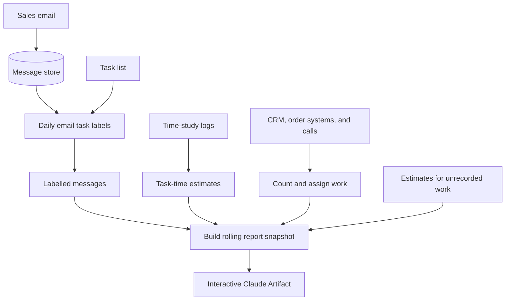

# Sales Capacity Planner

I built a tool that counts account work and estimates the time it takes, helping sales leaders understand team capacity.

[How it works](#how-it-works) · [Results and limitations](#results-and-limitations) · [Detailed evaluations](evaluations/README.md)

## At a glance

| Field | Value |
| --- | --- |
| Documentation status | Documentation draft |
| Project status | In use internally, with a live report and daily email classification; methods are still being refined |
| My role | Sales Operations; built the work counts, email classification, and reporting |
| Tools | SQL, Snowflake, Supabase, HubSpot, Front, Dialpad, n8n, Claude, Claude Artifacts, Python, Google Sheets |

## Problem and solution

**The gap:** Revenue was visible; the effort behind each account was not. Work was spread across email, CRM, order systems, and calls. Emails did not record the type of work or how long it took.

**What I built:** An interactive Claude Artifact that brings together work counts, labelled email, and task times from time studies. Leaders can explore:

- Estimated capacity by person.
- Estimated effort by account alongside revenue.
- Workload by activity type, with notes on the data and methods.

**Decisions it supports:** Who owns each account, how much support it needs, how service is delivered, when to hire, how roles are defined, and where to automate.

Different roles have different support arrangements. The page discourages ranking people across teams and flags missing email data instead of guessing.

## My contribution

### What I owned

- **Data and work counts:** Wrote warehouse queries and defined how to assign work when records did not clearly identify who did it.
- **Email classification:** Improved task labels by comparing them with manual labels. Set up historical and daily processing, and explored groups of similar emails to check the task categories.
- **Time estimates:** Used time-study logs to estimate task times, with broader benchmarks when a task had too few observations.
- **Reporting:** Built the report and its rolling data snapshot; documented methods, assumptions, and limitations.

### Collaborators and AI assistance

| Contributor | Responsibility |
| --- | --- |
| Executive leadership | Sponsored the study and helped set scope |
| Sales managers | Owned category definitions and coordinated time studies |
| Account managers | Recorded task durations |
| Engineering | Explained how source systems record who did the work |
| Claude in Cowork | Assisted with SQL, Python, and reporting code |
| Claude subagents | Perform email classification |

I chose the methods and rules, reviewed outputs, and checked the results.

## How it works

*Simplified data flow; internal database details and company data are omitted. Hours are estimates.*

### Estimating effort

The classifier reads the email and earlier messages in its thread, then returns a task label and a short explanation. Each task belongs to a predefined category. Task-time estimates vary by team, and account views show estimated effort alongside revenue.

| Activity | How time is estimated |
| --- | --- |
| Sent email | Estimated task time |
| Incoming email | Separate reading-time estimate to reduce double counting |
| Automated outbound | Counted, with no manual task time assigned |
| Coordination, meetings, and unrecorded work | Added time estimates |

## Results and limitations

### Classifier results

| Direct-review measure | v4 | v7 |
| --- | --- | --- |
| Agreement with manual labels | 67.3% | 82.7% |
| Category mix error | 11.5 points | 7.7 points |

The comparison used **156 messages from a single rater**. Messages were reviewed directly; the test did not run through the full automated process.

[Read the evaluation results, methods, and limitations →](evaluations/README.md)

### How to interpret capacity

- **Hours are estimates:** Task times come from limited time studies; some use assumptions or broader benchmarks.
- **Coverage is incomplete:** Email misses internal work, and matching calls by phone number can miss activity.
- **Account changes affect history:** Past work can appear under the current account owner.

Business impact and decisions made using the tool have not been documented for this case study.

## Decisions and lessons

- **Build on earlier learning:** Working on [Sock Scout](../sock-scout/README.md) introduced me to vector search. That experience led me to explore email embeddings (numerical representations of text), clustering similar emails, and checking how clearly categories differ.
- **Count work for the person who did it:** The record creator or account owner may not have done the work. Assignment rules need to reflect how each source system records activity.
- **Classify individual messages:** A conversation can contain several kinds of work. Labelling each message captures those differences, but a request and reply should not count as two completed tasks.
- **Set the category through the task:** A shared task list keeps email labels and time estimates consistent.
- **Check mistakes within each category:** Overall agreement can improve while one category gets worse. Reviewing individual errors and category results helps catch this.
- **Know when to stop:** I paused an efficiency analysis because the available measures could not show whether differences came from the accounts people handled or how they worked.

## Public documentation scope

This case study describes my contribution, the general approach, and evaluation summaries and figures. Business workload findings, customer and employee data, internal database details, full classifier prompts, and raw evaluation records are omitted. Source code and reporting pages are private; no public demo is available.
