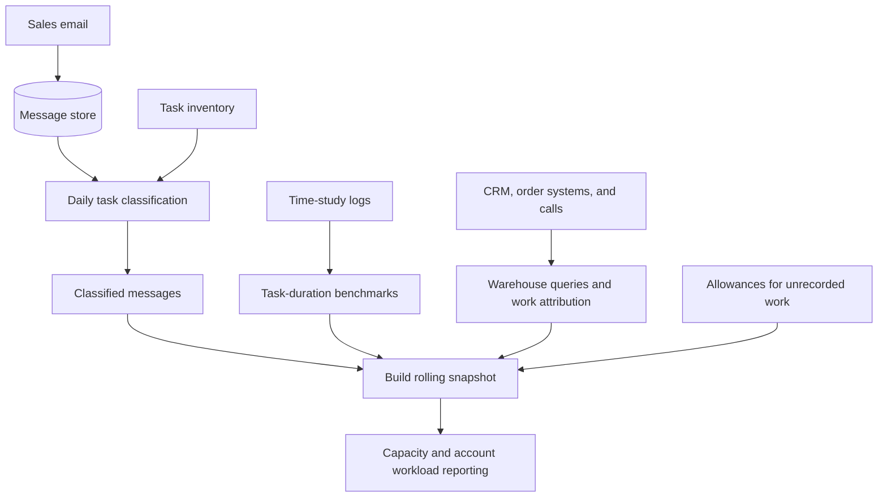

# Sales Capacity Planner

I built a sales capacity analysis tool that connects account activity to units of work and estimated effort. It helps sales leadership examine team capacity and account workload when considering account allocation, staffing, role design, and automation.

## Metadata

| Field | Value |
| --- | --- |
| Documentation status | Documentation draft |
| Project status | Active internally, with a live reporting page and daily email classification; methods are still being refined |
| My role | Sales Operations; responsible for work-unit measurement and the data, classification, and reporting layers |
| Tools | SQL, Snowflake, Supabase, HubSpot, Front, Dialpad, n8n, Claude, Python, Google Sheets |

## Problem and solution

Revenue reporting did not show the effort behind an account. Work was spread across email, CRM, order systems, and calls, with no consistent measure of workload. Email was especially difficult because messages had neither structured task labels nor recorded durations.

I combined production activity counts with email task classification and time-study benchmarks. The reporting page shows estimated capacity by person and estimated effort by account alongside revenue. These views support leadership review of account allocation, support coverage, service models, hiring, and role responsibilities.

Different roles have different responsibilities and support arrangements. The page discourages ranking people across teams and makes missing email coverage visible rather than filling it with inferred activity.

## My contribution

- Wrote warehouse queries to count production activity and attribute work to the person who performed it.
- Defined attribution rules for records with incomplete or ambiguous ownership.
- Built and iterated the email classifier against manually labelled examples, then established a backfill and daily classification process.
- Converted time-study logs into task-duration benchmarks, with fallbacks for sparse observations.
- Explored email embedding clusters as an independent check on the task taxonomy.
- Built the reporting pages and the process that combines classified email, production activity, calls, and revenue into a rolling snapshot.
- Documented methodology, assumptions, and limitations for leadership.

**Collaborators:** Executive leadership sponsored the study and helped set scope. Sales managers owned work-category definitions and coordinated time studies. Account managers recorded task durations, and engineering clarified source-system behavior that affected attribution.

**AI assistance:** I worked with Claude in Cowork to develop SQL, Python, and reporting code. Claude subagents perform email classification. I defined the methodology and rules, reviewed outputs, and ran validation.

## How it works

*Simplified architecture; internal schemas and company data are omitted. Reported hours are estimates.*

1. Email messages enter a data store and receive task labels from a defined inventory. The classifier uses thread context, returns a task and rationale, and derives the broader category from the inventory.
2. Time-study logs supply task-duration benchmarks for each team.
3. Warehouse queries count production work and call activity, attribute it to people and accounts, and retrieve revenue.
4. A build step combines these inputs into a rolling reporting snapshot.
5. Leaders explore workload by person, account, and activity type, with methodology and coverage information available alongside the estimates.

Sent messages receive task-duration estimates. Incoming messages receive a separate reading-time allowance to reduce double counting. Automated outbound messages remain visible as volume without assigned manual task time. Coordination, meetings, and other unrecorded work use explicit allowances.

## Validation and limitations

I evaluated classification quality, explored the task taxonomy, and checked reporting completeness separately. The evaluations used real internal email data. The methods are summarized here without publishing customer communications or company-specific results.

| Check | What I did | What it can establish |
| --- | --- | --- |
| Prompt comparison | Compared successive prompts against one account manager's manual labels, tracking agreement and category mix error separately | Whether labels match the reference and whether the distribution of work categories is distorted |
| Backfill audit | Used a separate read-only AI agent to review a random sample of classified records, checking category and task agreement and consistency across processing partitions | A limited check on the completed run; AI reviewer agreement is not human-verified accuracy |
| Category separability | Compared email embeddings using cosine similarity to explore category boundaries | Where message text is structurally ambiguous; this does not identify the actual classification errors by itself |
| Exploratory clustering | Applied UMAP and HDBSCAN to deduplicated email embeddings without supplying categories, then checked cluster stability across random seeds | An exploratory cross-check of the taxonomy, rather than a classification accuracy test |
| Snapshot reconciliation | Checked message totals by kind, unclassified records, duplicate identifiers, unmapped senders, and account matches on each refresh | Whether inputs are accounted for and mapping gaps are visible; reconciliation does not validate estimated hours |

I also used regression fixtures to check query changes. Together, these checks distinguish classification errors, data coverage gaps, and uncertainty in the effort model.

**Evaluation limits:** The manual reference came from a single rater and contained inconsistent labels. Prompt comparisons came from direct review rather than an end-to-end pipeline run. The original reference set is no longer retained, so those comparisons cannot be reproduced; a new labelled set is needed for the next evaluation. The backfill audit covered a small sample and used an AI reviewer. These checks do not establish general accuracy across all roles or future email.

Estimated hours are model outputs, not direct time tracking. Task benchmarks come from limited time studies, and some activities use assumptions or fallback durations. Email does not capture all internal work. Current account ownership can also shift historical work onto a new owner, and phone-based call matching can miss activity.

The live reporting page and daily classifier are in use internally. Business impact and resulting leadership decisions have not been documented for this case study.

## Decisions and lessons

- **Attribute work to the performer:** Record creation and account ownership do not reliably identify who completed the work. Attribution needs to reflect source-system behavior.
- **Classify individual messages:** A conversation can contain several kinds of work. Message-level labels preserve that distinction but require care to avoid counting a request and its reply as separate completed tasks.
- **Derive categories from tasks:** A fixed inventory keeps classification and duration benchmarks aligned.
- **Inspect errors and category distributions:** Overall agreement can improve while a particular category gets worse. Reviewing individual mistakes and category-level results helps expose that regression.
- **Keep uncertainty visible:** Sparse time studies, missing activity, and role differences limit how precisely the tool can describe individual capacity.
- **Stop unsupported comparisons:** I paused an efficiency analysis when the available proxies could not separate account mix from differences in how people work.

## Public documentation scope

This case study describes my contribution and the general approach. Company findings, workload figures, customer and employee data, internal schemas, classification rules, and evaluation records are omitted. Source code and reporting pages are private; no public demo is available.
