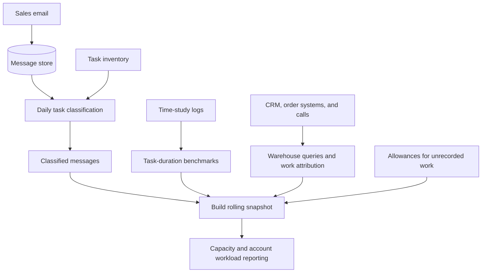

# Sales Capacity Planner

I built a sales capacity analysis tool that connects account activity to units of work and estimated effort.

[How it works](#how-it-works) · [Results and limitations](#results-and-limitations) · [Detailed evaluations](evaluations/README.md)

## At a glance

| Field | Value |
| --- | --- |
| Documentation status | Documentation draft |
| Project status | Active internally, with a live reporting page and daily email classification; methods are still being refined |
| My role | Sales Operations; responsible for work-unit measurement and the data, classification, and reporting layers |
| Tools | SQL, Snowflake, Supabase, HubSpot, Front, Dialpad, n8n, Claude, Python, Google Sheets |

## Problem and solution

**The gap:** Revenue was visible; the effort behind each account was not. Work was spread across email, CRM, order systems, and calls. Email had neither task labels nor recorded durations.

**What I built:** A reporting page that combines production activity, classified email, and time-study benchmarks to show:

- Estimated capacity by person.
- Estimated effort by account alongside revenue.
- Workload by activity type, with coverage and methodology available for review.

**Decisions it supports:** Account allocation, support coverage, service models, hiring, role design, and automation.

Different roles have different support arrangements. The page discourages cross-team ranking and shows missing email coverage rather than inferring activity.

## My contribution

### What I owned

- **Data and attribution:** Wrote warehouse queries and defined rules for incomplete or ambiguous ownership.
- **Classification:** Iterated the email classifier against manual labels, established backfill and daily runs, and explored embedding clusters to check the taxonomy.
- **Effort model:** Converted time-study logs into task-duration benchmarks, with fallbacks for sparse observations.
- **Reporting:** Built the rolling snapshot and reporting pages; documented methods, assumptions, and limitations.

### Collaborators and AI assistance

| Contributor | Responsibility |
| --- | --- |
| Executive leadership | Sponsored the study and helped set scope |
| Sales managers | Owned category definitions and coordinated time studies |
| Account managers | Recorded task durations |
| Engineering | Clarified source-system behavior affecting attribution |
| Claude in Cowork | Assisted with SQL, Python, and reporting code |
| Claude subagents | Perform email classification |

I defined the methodology and rules, reviewed outputs, and ran validation.

## How it works

*Simplified architecture; internal schemas and company data are omitted. Reported hours are estimates.*

### Estimating effort

The email classifier uses thread context to return a task and rationale. The broader category comes from the task inventory. Duration benchmarks vary by team, and account views pair estimated effort with revenue.

| Activity | Treatment in the model |
| --- | --- |
| Sent email | Task-duration estimate |
| Incoming email | Separate reading-time allowance to reduce double counting |
| Automated outbound | Visible as volume, without manual task time |
| Coordination, meetings, and unrecorded work | Explicit allowances |

## Results and limitations

### Classifier results

| Direct-review measure | v4 | v7 |
| --- | --- | --- |
| Agreement with manual labels | 67.3% | 82.7% |
| Category mix error | 11.5 points | 7.7 points |

The comparison used **156 messages from a single rater**. It was direct review, not an end-to-end pipeline test.

[Read the evaluation results, methods, and limitations →](evaluations/README.md)

### How to interpret capacity

- **Hours are estimates:** Benchmarks come from limited time studies, with assumptions and fallback durations.
- **Coverage is incomplete:** Email misses internal work, and phone-based call matching can miss activity.
- **Ownership can shift history:** Current account ownership can attribute historical work to a new owner.

Business impact and resulting leadership decisions have not been documented for this case study.

## Decisions and lessons

- **Attribute work to the performer:** Record creation and account ownership do not reliably identify who completed the work. Attribution needs to reflect source-system behavior.
- **Classify individual messages:** A conversation can contain several kinds of work. Message-level labels preserve that distinction but require care to avoid counting a request and its reply as separate completed tasks.
- **Derive categories from tasks:** A fixed inventory keeps classification and duration benchmarks aligned.
- **Inspect errors and category distributions:** Overall agreement can improve while a particular category gets worse. Reviewing individual mistakes and category-level results helps expose that regression.
- **Stop unsupported comparisons:** I paused an efficiency analysis when the available proxies could not separate account mix from differences in how people work.

## Public documentation scope

This case study describes my contribution, the general approach, and aggregate evaluation results. Business workload findings, customer and employee data, internal schemas, full classifier prompts, and raw evaluation records are omitted. Source code and reporting pages are private; no public demo is available.
